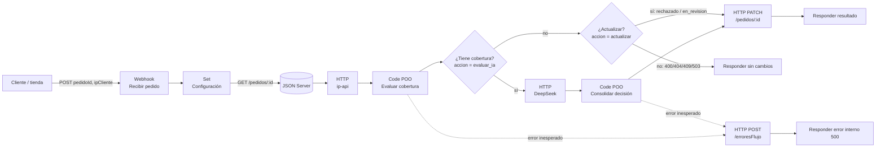
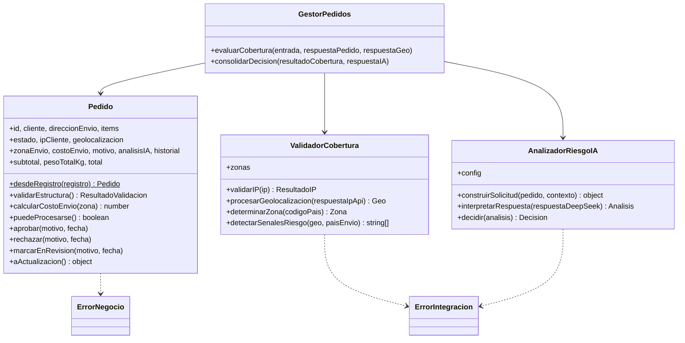

# Arquitectura · Pedidos con verificación geográfica de cobertura

Laboratorio #1 · Soluciones de Negocio (POO + n8n) · **Escenario 2**, con análisis de riesgo por DeepSeek como valor agregado.

---

## 1. Escenario y arquitectura de datos

### Problema

Una tienda en línea con sede en Costa Rica vende a Costa Rica, Centroamérica y Norteamérica. Cada pedido nuevo queda en JSON Server con estado `pendiente`. Hoy alguien revisa a mano si el cliente compra desde una zona atendida, calcula el envío según peso y destino, y decide si el pedido es confiable. Ese proceso es lento, inconsistente y no deja rastro.

El flujo automatiza esa decisión:

1. Recibe el pedido por **webhook** junto con la IP del cliente.
2. Consulta el registro en **JSON Server**.
3. Geolocaliza la IP con **ip-api.com**.
4. Aplica las reglas de cobertura y calcula el **costo de envío**.
5. Si hay cobertura, pide a **DeepSeek** un análisis de viabilidad y riesgo.
6. Actualiza el pedido en JSON Server como `aprobado`, `rechazado` o `en_revision`, con motivo e historial.

### Componentes

| Componente | Rol | Dónde vive |
|---|---|---|
| Tienda / cliente HTTP | Envía `{ pedidoId, ipCliente }` al webhook | Externo |
| n8n | Orquesta llamadas, bifurca y responde | `n8n/workflow-pedidos-cobertura.json` |
| JSON Server | Base de datos REST de pedidos | `db.json` (desde `datos/db.seed.json`) |
| ip-api.com | Geolocalización de la IP | `http://ip-api.com/json/{ip}` |
| DeepSeek API | Análisis de viabilidad y riesgo | `https://api.deepseek.com/chat/completions` |
| Clases POO | Toda la lógica de negocio | `src/` (incrustadas en los nodos Code) |

### Flujo de datos



Paso a paso, con la forma de los datos en cada salto:

| # | Nodo | Entra | Sale |
|---|---|---|---|
| 1 | **Recibir pedido** (Webhook POST, Header Auth) | `{ "pedidoId": "PED-1001", "ipCliente": "201.191.20.10" }` | `{ headers, body, query, ... }` |
| 2 | **Configuración** (Set) | — | `{ jsonServerUrl }` (único lugar con la URL base) |
| 3 | **Consultar pedido en JSON Server** (GET) | `pedidoId` del webhook | `{ statusCode, body: <pedido> }` o `{ error }` |
| 4 | **Geolocalizar IP (ip-api)** (GET) | `ipCliente` del webhook | `{ status, countryCode, city, proxy, hosting, ... }` o `{ error }` |
| 5 | **Evaluar cobertura (POO)** (Code) | 1 + 3 + 4 | `{ accion, httpStatus, mensaje, pedidoId, pedido, evaluacion, solicitudIA, actualizacion }` |
| 6 | **¿Tiene cobertura?** (IF) | `accion` | rama *true* si `accion = evaluar_ia` |
| 7 | **Analizar riesgo con DeepSeek** (POST) | `solicitudIA` (armada por la clase) | `{ choices[0].message.content }` o `{ error }` |
| 8 | **Consolidar decisión (POO)** (Code) | 5 + 7 | mismo formato que 5, con `accion = actualizar` |
| 9 | **¿Requiere actualizar el pedido?** (IF) | `accion` | *true* si `actualizar`; *false* si `omitir` |
| 10 | **Actualizar pedido en JSON Server** (PATCH) | `actualizacion` | pedido actualizado o `{ error }` |
| 11 | **Responder resultado** / **Responder sin cambios** | — | JSON al cliente con el estado o el motivo |

El contrato entre nodos es el campo **`accion`**:

| `accion` | Significado | Siguiente paso |
|---|---|---|
| `evaluar_ia` | Pasó R1, R2, R3 y R5 | DeepSeek → fase 2 |
| `actualizar` | Hay decisión (`aprobado` / `rechazado` / `en_revision`) | PATCH en JSON Server |
| `omitir` | No se debe tocar el pedido | Responder con `httpStatus` |

---

## 2. Modelo de clases



- **Pedido** sabe de sí mismo: estructura, peso, montos, costo de envío y estados.
- **ValidadorCobertura** sabe de ubicación: formato de IP, rangos privados, respuesta de ip-api y zonas.
- **AnalizadorRiesgoIA** sabe de DeepSeek: qué enviar (sin datos personales), cómo validar lo que vuelve y cómo convertirlo en decisión.
- **GestorPedidos** solo orquesta, y sus dos métodos públicos son exactamente los dos nodos Code.

---

## 3. Sincronización POO ↔ nodo Code

n8n no puede importar archivos locales desde un nodo Code. Para no copiar código a mano:

1. `scripts/generar-nodos-n8n.js` concatena `src/` en orden de dependencias, quita `import`/`export` y añade un **adaptador** de pocas líneas (`n8n/adaptadores.js`) que solo lee los nodos anteriores y llama a `GestorPedidos`.
2. El resultado se escribe en `n8n/codigo-generado/*.js` (para pegar a mano si se prefiere) y se inyecta en `n8n/workflow-pedidos-cobertura.json`.
3. `tests/nodosN8n.test.js` falla si el JSON versionado no coincide con lo generado, y además **ejecuta el código del nodo Code** con `$()` y `$input` simulados y comprueba que da el mismo resultado que las clases.

Adaptador de la fase 1 (todo lo demás del nodo es `src/` literal):

```js
const webhook = $('Recibir pedido').first().json;

const resultado = new GestorPedidos().evaluarCobertura({
  entrada: webhook.body ?? {},
  respuestaPedido: $('Consultar pedido en JSON Server').first().json,
  respuestaGeo: $('Geolocalizar IP (ip-api)').first().json,
});

return [{ json: resultado }];
```

---

## 4. Configuración de nodos

| Nodo | Tipo | Configuración clave |
|---|---|---|
| Recibir pedido | Webhook v2 | `POST /pedidos/verificar-cobertura` · Authentication: **Header Auth** · Respond: *Using 'Respond to Webhook' node* |
| Configuración | Set v3.4 (JSON) | `{ "jsonServerUrl": "http://localhost:3000", "iaUrl": "…", "iaModelo": "deepseek/deepseek-chat" }` |
| Consultar pedido en JSON Server | HTTP Request v4.2 | `GET {{jsonServerUrl}}/pedidos/{{pedidoId}}` · Response: *Include headers and status* + *Never error* · Timeout 5 s · Retry 2 · On Error: *Continue* |
| Geolocalizar IP (ip-api) | HTTP Request v4.2 | `GET http://ip-api.com/json/{{ipCliente}}?fields=status,message,country,countryCode,regionName,city,lat,lon,isp,proxy,hosting,query&lang=es` · Timeout 5 s · Retry 2 · On Error: *Continue* |
| Evaluar cobertura (POO) | Code v2 (JS, una vez para todos los ítems) | Código generado `n8n/codigo-generado/evaluar-cobertura.js` |
| ¿Tiene cobertura? | IF v2 | `{{ $json.accion }}` *is equal to* `evaluar_ia` |
| Analizar riesgo con DeepSeek | HTTP Request v4.2 | `POST {{iaUrl}}` (por defecto OpenRouter, `https://openrouter.ai/api/v1/chat/completions`, con el modelo `deepseek/deepseek-chat`; también admite la API directa `https://api.deepseek.com/chat/completions` + `deepseek-chat`) · Auth: Generic → Header Auth (`Authorization: Bearer <API key>`) · Body: `solicitudIA` con `model = iaModelo` · Timeout 30 s · Retry 2 · On Error: *Continue* |
| Consolidar decisión (POO) | Code v2 | Código generado `n8n/codigo-generado/consolidar-decision.js` |
| ¿Requiere actualizar el pedido? | IF v2 | `{{ $json.accion }}` *is equal to* `actualizar` |
| Actualizar pedido en JSON Server | HTTP Request v4.2 | `PATCH {{jsonServerUrl}}/pedidos/{{pedidoId}}` · Body `{{ JSON.stringify($json.actualizacion) }}` · On Error: *Continue* |
| Responder resultado | Respond to Webhook v1.1 | 200 con estado, motivo, envío, total y mensaje de la IA; 502 si el PATCH falló |
| Responder sin cambios | Respond to Webhook v1.1 | Código `{{ $json.httpStatus }}` (400, 404, 409, 502, 503) |

Todos los nodos HTTP usan *On Error → Continue (regular output)*: si un servicio falla, el nodo entrega `{ error }` y **la clase decide** la ruta segura, en lugar de que la ejecución muera a mitad de camino.

**Errores inesperados, dentro del mismo flujo.** Los dos nodos Code tienen *On Error → Continue (using error output)*. Si lanzan una excepción no prevista (un bug, porque las fallas previstas ya las resuelven las clases), la segunda salida va a **Registrar error inesperado**, que hace POST a `/erroresFlujo` de JSON Server con flujo, nodo, mensaje, pedido e ID de ejecución. Después, **Responder error interno** devuelve 500 al cliente. Todo queda en un solo workflow, sin un Error Workflow aparte.

| Nodo | Tipo | Configuración clave |
|---|---|---|
| Registrar error inesperado | HTTP Request v4.2 | `POST {{jsonServerUrl}}/erroresFlujo` · On Error: *Continue* |
| Responder error interno | Respond to Webhook v1.1 | 500 con mensaje genérico (sin detalles internos) |

---

## 5. Reglas de negocio y manejo de errores

### Reglas

| # | Regla | Implementación | Resultado si falla |
|---|---|---|---|
| **R1** | **Estructura e IP válidas.** El pedido trae cliente con nombre y correo válido, dirección con país ISO-2, ciudad y detalle, de 1 a 50 artículos con cantidad entera 1–100, precio > 0 y peso ≥ 0. La IP es IPv4/IPv6 con formato estricto y **pública** (se descartan 10/8, 172.16/12, 192.168/16, 127/8, 100.64/10, 169.254/16, rangos de documentación, multicast, `::1`, `fc00::/7`, `fe80::/10`, `2001:db8::/32`…). | `Pedido.validarEstructura()`, `ValidadorCobertura.validarIP()` | `rechazado` con la lista de errores |
| **R2** | **Cobertura geográfica.** La IP debe ubicarse en un país con cobertura **y** el destino también. Zonas: NACIONAL (CR), CENTROAMERICA (PA, NI, SV, GT, HN, BZ), NORTEAMERICA (US, MX, CA). | `ValidadorCobertura.determinarZona()` | `rechazado` "Sin cobertura…" |
| **R3** | **Envío dinámico.** `tarifaBase + ⌈peso kg⌉ × tarifaPorKg` de la zona de destino; gratis si el subtotal supera el umbral de la zona (CR ≥ $75, Norteamérica ≥ $250); rechazo si supera el peso máximo (30/20/15 kg). | `Pedido.calcularCostoEnvio(zona)` | `rechazado` por `PESO_EXCEDIDO` |
| **R4** | **Validación analítica con DeepSeek.** Solo se consulta si R1–R3 pasaron. Se envían artículos, montos, país/ciudad y señales de riesgo (proxy, hosting, país IP ≠ destino), **nunca** nombre, correo ni dirección exacta. La respuesta debe ser JSON con esquema estricto. Se rechaza si `viable = false`, `riesgo = alto` o `puntaje ≥ 70`. | `AnalizadorRiesgoIA` | `rechazado` con motivos de la IA |
| **R5** | **Control de estados e idempotencia.** Solo entran pedidos `pendiente` o `en_revision`; `aprobado` y `rechazado` son finales. Cada transición queda en `historial` con fecha y motivo. Reenviar el mismo webhook no reprocesa un pedido cerrado. | `Pedido.puedeProcesarse()`, `Pedido._cambiarEstado()` | `omitir` con HTTP 409 |

### Manejo de errores

Principio: **una regla incumplida rechaza el pedido; una falla nuestra no**. Si no pudimos verificar algo por culpa de un servicio externo, el pedido queda `en_revision` para un humano, en vez de rechazar a un cliente legítimo o aprobar a ciegas.

| Situación inesperada | Detección | Ruta de salida |
|---|---|---|
| **ip-api caída**, timeout o límite de 45 req/min | Nodo HTTP con *Continue* entrega `{ error }` → `procesarGeolocalizacion()` lanza `ErrorIntegracion` → `try/catch` en `GestorPedidos` | `en_revision`: "No se pudo verificar la ubicación…" |
| **DeepSeek caída**, sin saldo, timeout | `{ error }` → `interpretarRespuesta()` lanza `ErrorIntegracion` | `en_revision`: "Análisis de riesgo no disponible…" |
| **DeepSeek responde algo que no es el JSON pedido** (texto libre, campos faltantes, valores fuera de rango, intento de inyección) | `JSON.parse` en `try/catch` + validación de esquema | `en_revision` (no se confía en salida mal formada) |
| **IP privada, reservada o mal formada** | `validarIP()` antes de usar la geolocalización | `rechazado` con motivo claro |
| **IP que ip-api no logra ubicar** (`status: "fail"`) | `procesarGeolocalizacion()` lanza `ErrorNegocio` | `rechazado` |
| **JSON Server caído** | `{ error }` en la consulta | `omitir` 503; no hay nada que actualizar |
| **Pedido inexistente** / `pedidoId` inválido | `statusCode 404` / regex del ID | `omitir` 404 / 400 |
| **Falla al guardar** (PATCH) | `{ error }` en el PATCH | Respuesta 502 al cliente |
| **Error de programación** (bug) | Excepción no controlada en un nodo Code → salida de error | Registro en `/erroresFlujo` + respuesta 500 |

Seguridad incluida en el diseño:

- Webhook protegido con credencial Header Auth; API key de DeepSeek en el gestor de credenciales de n8n, nunca en el código.
- `pedidoId` e IP se codifican con `encodeURIComponent` en las URLs y el ID se valida con `^[A-Za-z0-9_-]{1,40}$`; además se verifica que el registro devuelto corresponda al ID pedido.
- El prompt de sistema le indica a la IA que trate el pedido como datos y no como instrucciones; aun así, la seguridad no depende del prompt: la IA solo puede **endurecer** la decisión, nunca aprobar algo que R1–R3 rechazaron, y su salida se valida contra un esquema.
- Los textos que vienen de fuera (motivos de la IA, mensaje al cliente, IP en mensajes) se recortan antes de guardarse.
