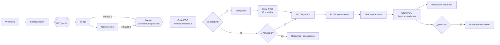
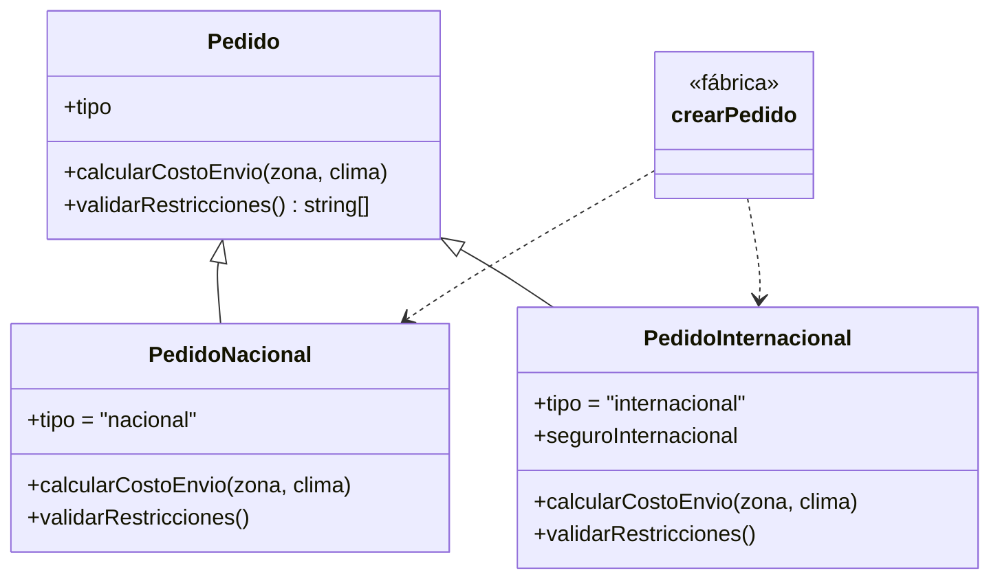

# Retos de extensión

Los cuatro retos opcionales están implementados en el mismo workflow y en las mismas clases. Todo se verifica con `npm test` y `npm run probar`.

---

## Reto 1 · Herencia y polimorfismo

| Método | `Pedido` (base) | `PedidoNacional` | `PedidoInternacional` |
|---|---|---|---|
| `calcularCostoEnvio(zona, clima)` | base + ⌈kg⌉ × tarifa; gratis sobre el umbral | base (`super`) **+ $2 fijos** si el clima es severo; respeta el envío gratis | base (`super`) **+ 20 %** si el clima es severo **+ seguro** de 1.5 % del valor (mín. $3) |
| `validarRestricciones()` | `[]` | `[]` | máx. **5 unidades por SKU** y **$5 000** de valor declarado |

- `crearPedido(registro)` (en `src/modelos/fabricaPedidos.js`) es el único lugar que conoce las subclases: elige `PedidoNacional` si el destino es CR y `PedidoInternacional` en cualquier otro caso.
- `GestorPedidos` llama a `pedido.calcularCostoEnvio()` y a `pedido.validarRestricciones()` sin preguntar el tipo: eso es el polimorfismo.
- **Nodo Code:** el generador incluye `PedidoNacional.js`, `PedidoInternacional.js` y `fabricaPedidos.js` en los tres nodos Code. Una prueba verifica que el código contiene `class PedidoNacional extends Pedido` y otra ejecuta los nodos y compara su resultado con el de las clases.

Ejemplo real: PED-1004 (12 smartphones por $10 788 a Panamá) ahora se rechaza por regla, con el código `RESTRICCION_INTERNACIONAL`, antes de gastar una consulta en la IA.

## Reto 2 · Segunda fuente externa + Merge

**API:** [Open-Meteo](https://open-meteo.com/). Es gratuita y no necesita API key.

| Nodo | Configuración |
|---|---|
| **Consultar clima (Open-Meteo)** · HTTP Request | `GET https://api.open-meteo.com/v1/forecast?latitude={{ $json.lat }}&longitude={{ $json.lon }}&current=temperature_2m,precipitation,weather_code,wind_speed_10m&timezone=auto` · timeout 5 s · *On Error: Continue* |
| **Combinar geolocalización y clima** · Merge v3 | *Mode:* **Combine** · *Combine By:* **Position** · entrada 1 = ip-api, entrada 2 = Open-Meteo |

Conexiones: **ip-api** se conecta a la entrada 1 del Merge **y** a Open-Meteo, que usa su `lat`/`lon`; **Open-Meteo** se conecta a la entrada 2. El Merge espera a ambas entradas y entrega un único ítem con los campos de las dos APIs, que lee el nodo Code.

**Clase `AnalizadorClima`:** traduce el código WMO a texto y marca el clima como **severo** si hay tormenta, lluvia o nieve intensa, viento ≥ 60 km/h o precipitación ≥ 10 mm. Ese resultado entra al cálculo polimórfico del envío.

**Errores:** si Open-Meteo falla, el pedido continúa sin recargo (`clima.disponible = false`). Como en el ítem combinado el campo `error` puede venir de Open-Meteo, `ValidadorCobertura` decide si ip-api falló mirando su propio campo `status`.

## Reto 3 · Notificación por correo

| Nodo | Configuración |
|---|---|
| **¿Requiere notificación?** · IF | `{{ $('Analizar tendencia (POO)').first().json.notificacion.debeNotificar }}` *is true* |
| **Enviar alerta por correo** · Send Email v2.1 | Credencial **SMTP** · *From:* `correoRemitente` · *To:* `correoAlertas` (ambos en el nodo **Configuración**) · *Email Format:* HTML · *Subject:* `notificacion.asunto` · *HTML:* `notificacion.html` · *On Error: Continue* |

**Clase `NotificadorAlertas`:** decide qué se notifica y arma el correo, escapando el HTML.

| Código de motivo | Nivel |
|---|---|
| `SIN_COBERTURA` | advertencia |
| `RESTRICCION_INTERNACIONAL`, `RIESGO_IA`, `SERVICIO_NO_DISPONIBLE` | crítico |

El correo incluye el pedido, la ubicación de la IP, el clima, el envío, **el análisis de DeepSeek** (viabilidad, riesgo, motivos y mensaje sugerido) y la conclusión de la tendencia. En un rechazo por cobertura, DeepSeek no se consulta, para no pagar por la IA en pedidos que ya no proceden, y el correo lo indica.

La respuesta al webhook sale **antes** del correo, así el cliente no espera al SMTP.

**Gmail:** la credencial SMTP necesita una **contraseña de aplicación**, no la contraseña normal de la cuenta (Cuenta de Google → Seguridad → Verificación en 2 pasos → Contraseñas de aplicación). Usa host `smtp.gmail.com`, puerto 465 y SSL/TLS activado.

## Reto 4 · Historial y tendencia

| Nodo | Configuración |
|---|---|
| **Registrar ejecución en historial** · HTTP Request | `POST {{jsonServerUrl}}/ejecuciones` · cuerpo `registroHistorial`, generado por la clase |
| **Consultar historial de ejecuciones** · HTTP Request | `GET {{jsonServerUrl}}/ejecuciones?_sort=fecha&_order=desc&_limit=20` · *Always Output Data* activado |
| **Analizar tendencia (POO)** · Code | `GestorPedidos.cerrarEjecucion()` → `HistorialTendencia.analizar()` |

**Clase `HistorialTendencia`:**
- `crearRegistro(pedido, fecha)` guarda solo `pedidoId`, `tipoPedido`, `estado`, `codigoMotivo`, `zonaEnvio`, `paisIP`, `riesgoIA`, `total` y `fecha`, sin datos personales.
- `analizar(registros)` toma hasta 20 ejecuciones, las divide en *recientes* y *anteriores*, y compara la **tasa de rechazo** y la **tasa sin cobertura**. Un cambio mayor a 10 puntos se clasifica como `mejorando` o `empeorando`; si no, `estable`. Con menos de 4 ejecuciones, el resultado es `datos_insuficientes`.

La conclusión aparece en la **respuesta del webhook** (`tendencia.conclusion`), en el correo y en el panel web.

---

## Panel web

`public/` se sirve automáticamente en **http://localhost:3000** junto con la API de JSON Server.

- Procesa un pedido existente o crea uno nuevo, con ejemplos precargados, y lo envía al webhook.
- Muestra cada paso del flujo, el clima, el análisis de DeepSeek y la tendencia.
- Incluye KPIs y una franja de las últimas ejecuciones, con tooltip, ícono y texto por estado.
- Tabla de pedidos con filtros y vista de detalle (geolocalización, clima, IA e historial de estados).
- Modo día y noche: respeta la preferencia del sistema y se guarda en el navegador.
- La clave del webhook se configura en **Ajustes** y se guarda solo en el navegador.
